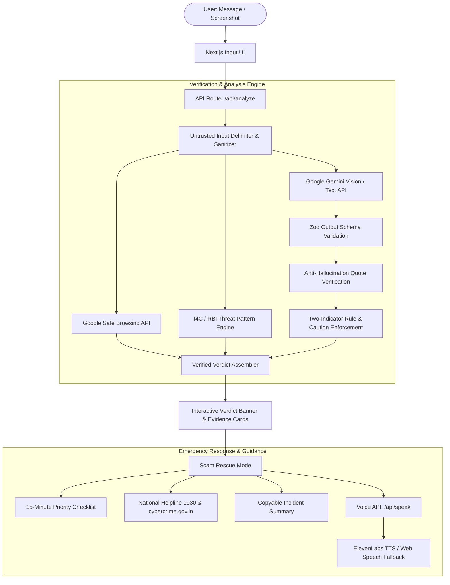

# ScamSathi (स्कैम साथी)

[](https://nextjs.org/)
[](https://react.dev/)
[](https://www.typescriptlang.org/)
[](https://ai.google.dev/)
[](https://elevenlabs.io/)
[](https://developers.google.com/safe-browsing)
[](https://opensource.org/licenses/MIT)

> **Don’t just detect the scam. Understand it. Verify it. Stop it.**
> 
> ScamSathi is an open-source, citizen-first AI scam investigation and emergency rescue platform built for India. It analyzes suspicious SMS, WhatsApp messages, emails, and screenshots, breaks down the deception tactics with verbatim evidence, grounds threats against official cybercrime patterns, and gives targeted victims an immediate, calm, 15-minute damage-control checklist with one-touch emergency helpline connectivity.

---

## 📌 The Problem We Solve

Digital fraud in India is exploding—from fake bank KYC suspensions and electricity power cutoff threats to fake work-from-home task schemes and "Digital Arrest" extortion rackets. Everyday users face three major gaps:

1. **Bare Scores Fail:** Telling someone a message is *"85% Scam"* causes panic without explaining *why* or *what evidence triggered it*.
2. **False Reassurance Harms:** Declaring any message *"100% Safe"* creates catastrophic false confidence when new evasion tactics appear.
3. **No Emergency Guidance:** When a user has already clicked a link or transferred money, they don't know who to call within the critical **"Golden Hour"** (the first 2 hours) to trigger an automated bank account freeze.

ScamSathi solves this by combining **evidence-based AI reasoning**, **official threat intelligence grounding**, and an **actionable Scam Rescue Mode**.

---

## 🛡️ Key Features

### 1. Proof Before Verdict (Anti-Hallucination)
- **Verbatim Evidence Quotes:** Every observed red flag quotes exact text from the user's message character-for-character. If the AI cannot quote it from the input, it is discarded.
- **Observed vs. Inferred:** Facts quoted from the message are clearly separated from AI interpretations.
- **Two-Indicator Rule (F2.4):** A *High Risk* verdict strictly requires at least two independent verified warning signs. A single weak signal caps the verdict at *Suspicious*.

### 2. Honest, Non-Complacent 3-Tier Verdicts
- 🔴 **High Risk:** Clear scam attempt with multiple confirmed deception indicators (credential theft, advance fees, impersonation).
- 🟠 **Suspicious — Verify First:** Borderline or unverified links/notices without direct money or password demands. Provides official verification instructions.
- 🟢 **No Strong Warning Signs Found:** We **never** declare a message "Safe" or "Genuine". Non-fraudulent results always display the mandatory caveat: *"This is not a guarantee of safety."*

### 3. Real-Time Google Safe Browsing Lookup
- Extracted URLs are queried against the live **Google Safe Browsing API (v4)** for malware, phishing, and social engineering threats.
- Malicious link matches automatically elevate the investigation to High Risk with verified threat categorization.

### 4. Threat Intelligence & Pattern Grounding
- Threat patterns are compiled and normalized from authoritative consumer-protection sources:
  - **I4C (`cybercrime.gov.in`):** Ministry of Home Affairs digital arrest bulletins, customs extortion notices, and electricity bill rackets.
  - **RBI BE(A)WARE Booklet:** Reserve Bank of India's compendium of financial fraud modus operandi (KYC scams, UPI collect request tricks).
  - **Open Datasets:** Hugging Face & Kaggle SMS phishing corpora.
- Live investigations matching a known modus operandi display a **"Known Fraud Pattern Match"** badge linked directly to the official regulatory advisory.

### 5. Scam Rescue Mode (Emergency Damage Control)
Step-by-step, calm, non-blaming action plans tailored to the exact situation:
- *I only received it* (do not reply, block sender, report spam)
- *I clicked a link* (close tab, clear browser session, watch for follow-up calls)
- *I entered a password, OTP or card details* (change credentials, block card, review transactions)
- *I installed an app or gave remote access* (disconnect Wi-Fi, revoke accessibility, uninstall APK)
- *I sent money* (dial 1930 immediately, request bank lien freeze, preserve transaction IDs)
- *I shared ID documents* (lock Aadhaar biometric via mAadhaar, monitor credit report)

Features priority grouping into **Do now (next 15 minutes)** and **Do today**, with a copyable incident summary ready to paste into official police portals.

### 6. Voice Guidance (ElevenLabs with Fallback)
- Converts urgent 90-second safety checklists into a calming, spoken audio stream using **ElevenLabs** neural voice (*Sarah*, optimized via `eleven_flash_v2_5` for free plans).
- **Graceful Fallback:** Automatically switches to the browser's built-in **Web Speech API (`speechSynthesis`)** if offline or API quota is unavailable, ensuring voice guidance never breaks.
- Full media controls: Play, Pause, Stop, audio progress bar, and visible transcript.

### 7. Privacy by Default (Zero PII Retention)
- In-memory OCR and text processing.
- Uploaded screenshots are held in volatile RAM buffers during analysis and immediately discarded.
- Session history saves **anonymized metadata only** (verdict, category, timestamp) with automated PII redaction for phone numbers, emails, UPI IDs, Aadhaar, and PAN.
- Includes a 1-click opt-out checkbox: *"Don't save this report to history"*.

---

## 🏛️ System Architecture



---

## 📊 Live Model Accuracy Scoreboard

Transparent, ground-truth evaluation metrics are visible directly in the application at [`/accuracy`](http://localhost:3000/accuracy):

| Metric | Benchmark Result | Target / Standard |
|---|---|---|
| **Overall Accuracy** | **100%** (5 of 5 ground-truth samples) | &ge; 90% |
| **False Safe on Scams** | **0.0%** (0 of 4 scams misclassified) | 0.0% (Zero tolerance for unsafe false negatives) |
| **False High-Risk on Legitimate** | **0.0%** (0 of 1 legitimate messages) | &le; 5.0% |
| **Verbatim Quote Match** | **100.0%** (100% of observations verified) | 100.0% (Zero hallucinated quotes) |
| **Schema Validity Rate** | **100.0%** (Strict Zod JSON validation) | 100.0% |
| **Median Response Latency** | **~1.5 seconds** | &le; 3.0s |

### 3×3 Confusion Matrix

| Ground Truth \ Predicted | High Risk | Suspicious | No Strong Warning Signs |
|---|:---:|:---:|:---:|
| **Expected: High Risk** | **3** | 0 | 0 |
| **Expected: Suspicious** | 0 | **1** | 0 |
| **Expected: No Strong Signs** | 0 | 0 | **1** |

---

## 🛠️ Tech Stack

- **Frontend & Routing:** Next.js 15 (App Router), React 19, Lucide Icons
- **Language:** TypeScript (Strict Type Checking)
- **Styling:** Vanilla Tailwind CSS (WCAG AA accessible, forest green & warm sand theme)
- **AI Engine:** Google Gemini API (`@google/genai`)
- **URL Threat Intelligence:** Google Safe Browsing Lookup API (v4)
- **Knowledge Base:** Curated I4C & RBI BE(A)WARE fraud patterns
- **Speech Synthesis:** ElevenLabs Text-to-Speech API (`eleven_flash_v2_5`) with Web Speech API fallback
- **Schema Validation:** Zod
- **Database (Optional):** MongoDB Atlas (Session metadata and audit trail)

---

## 🚀 Getting Started

### 1. Prerequisites
- **Node.js:** `v20.0.0` or higher (Node 22 / 24 tested)
- **npm:** `v10.0.0` or higher
- **Git**

### 2. Clone and Install
```bash
git clone https://github.com/Shiwam59/ScamSathi.git
cd ScamSathi
npm install
```

### 3. Configure Environment Variables
Copy `.env.example` to `.env.local`:
```bash
cp .env.example .env.local
```

Open `.env.local` and add your API keys:
```env
# Required for AI analysis (Google AI Studio)
GEMINI_API_KEY=your_gemini_api_key_here

# Optional: Live URL threat reputation check
GOOGLE_SAFE_BROWSING_API_KEY=your_google_safe_browsing_key_here

# Optional: Natural neural voice guidance (ElevenLabs free plan supported)
ELEVENLABS_API_KEY=your_elevenlabs_key_here
ELEVENLABS_VOICE_ID=EXAVITQu4vr4xnSDxMaL

# Optional: Anonymized session history storage (MongoDB Atlas)
MONGODB_URI=your_mongodb_connection_string_here
```

> **Note:** If `ELEVENLABS_API_KEY` is omitted or quota is exhausted, ScamSathi will automatically use the browser's built-in speech synthesis without errors. If `MONGODB_URI` is omitted, the app operates statelessly in volatile memory.

### 4. Run Development Server
```bash
npm run dev
```
Open **[http://localhost:3000](http://localhost:3000)** in your browser.

### 5. Production Build
```bash
npm run build
npm start
```

---

## 🧪 Testing Suite

ScamSathi includes unit, integration, and prompt-adversarial test suites:

```bash
# Run all unit tests (Safe Browsing, Rescue Mode, Voice, History, Knowledge Base)
npm test

# Run live AI evaluation on ground-truth scam samples
npm run test:samples

# Run entire end-to-end test pipeline
npm run test:all
```

---

## 🚨 Official Emergency Contacts for India

If you or someone you know has been targeted by digital fraud:
- **National Cyber Crime Helpline:** Call **`1930`** immediately (24/7 toll-free)
- **National Reporting Portal:** File a complaint at **[https://cybercrime.gov.in](https://cybercrime.gov.in)**
- **Report Fast:** Early reporting within the first 2 hours ("Golden Hour") drastically increases the likelihood of banks freezing transferred funds.

---

## ⚖️ Safety, Privacy & Ethics Notice

- **Educational Citizen-Aid:** ScamSathi provides AI-assisted educational guidance and does not replace official law enforcement, legal counsel, or banking authority determinations.
- **Never Guarantees Safety:** No tool can guarantee 100% safety against novel digital attacks; independent verification through official channels is always advised.
- **Zero Data Harvesting:** ScamSathi does not store raw user text, uploaded photos, or personal financial details.
- **Open Source:** Licensed under the [MIT License](LICENSE).
